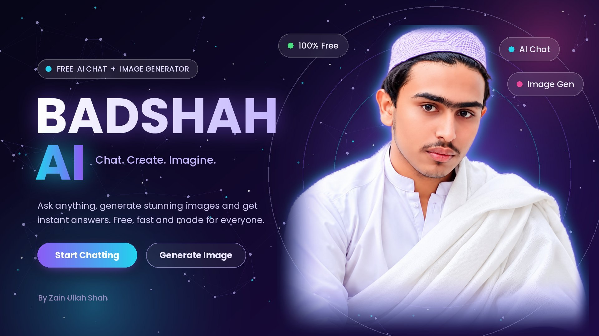
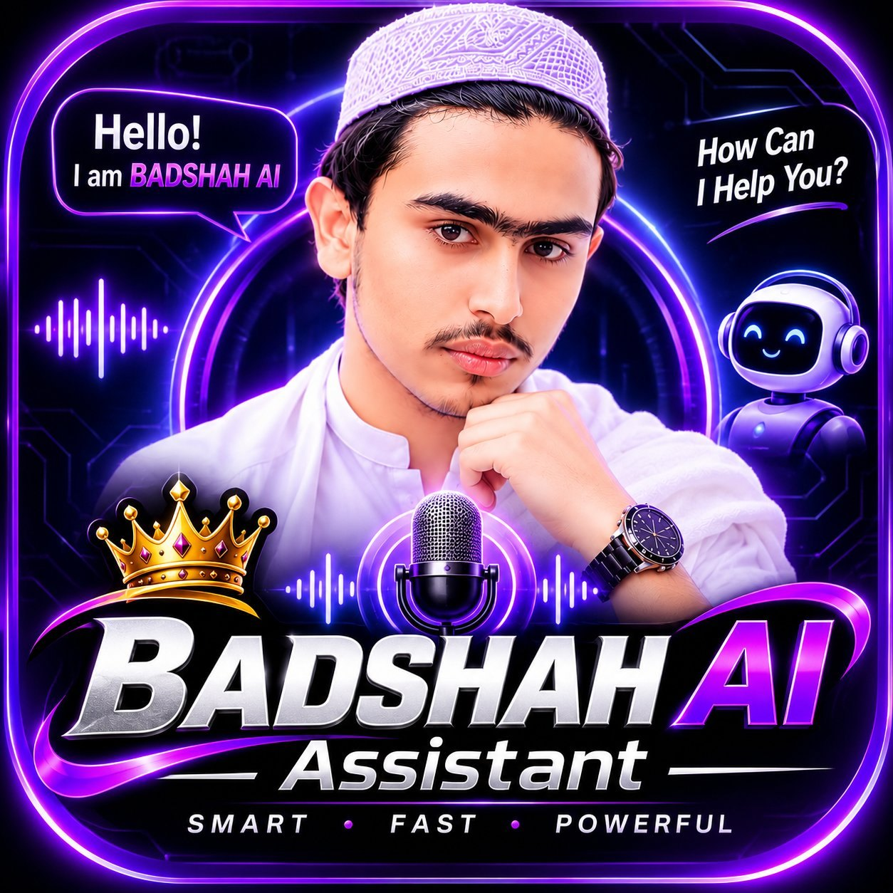
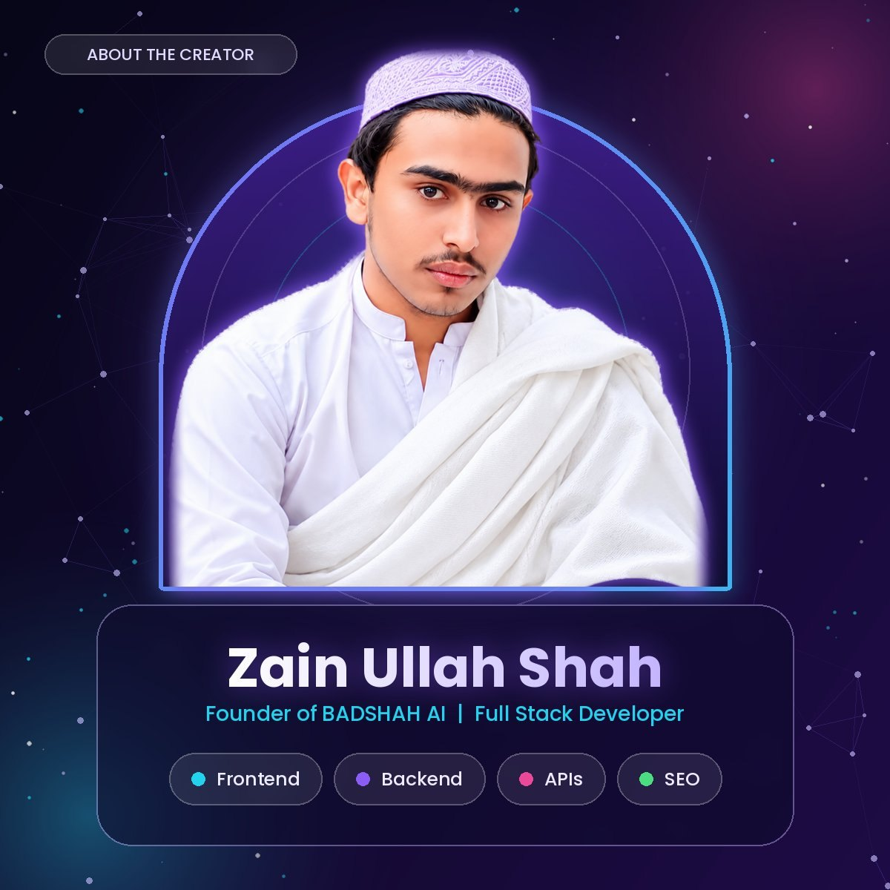

# 👑 BADSHAH AI — Your Personal AI Voice Assistant



**BADSHAH AI** is a complete personal AI voice-assistant ecosystem: an Android app that talks with you in a **real human voice**, a violet-neon admin panel, a Supabase backend, Firebase sign-in, and a Cloudflare-hosted website — designed, built and owned by **Zain Ullah Shah (Badshah)**.

Talk to it like a person. It listens, understands your mood, answers in your own style, controls your phone, and remembers your conversations.

---

## 📸 Gallery

| App icon | The creator | Portrait | AI assistant (AISHA) |
|---|---|---|---|
|  |  |  |  |

---

## ✨ Features

### 🎙️ Real human voices — Gemini Live
- Voice Call runs on **Google Gemini Live**: real-time, natural human voices — the same technology used by LIA AI and MYRA AI. No robotic phone text-to-speech.
- **30 built-in voices** — 14 male (Charon, Orus, Fenrir, Puck, Algieba…) and 16 female (Aoede, Kore, Zephyr, Leda, Sulafat…), each with its own style.
- **Barge-in**: start speaking and the assistant stops and listens, like a real call.
- Live transcripts of both sides, saved into chat history.
- The Live model is **auto-detected from your own Gemini API key** — nothing is hard-coded or invented.
- Classic listen → think → speak mode remains as an automatic fallback, and **ElevenLabs** can be connected (optional) for premium chat-reply voices.

### ❤️ Emotions that you can hear
- A fresh set of **30 emotions** (Warm, Joy, Calm, Love, Energy, Deep) — each one changes how the voice actually sounds.
- **Auto mode** reads your mood from your words: comfort when you are sad, calm when you are angry, celebration when you succeed — and mirrors your own style of talking.

### 🧠 Personalities & Brains
- **7 personalities**: Assistant, Teacher, Boyfriend, Girlfriend, Father, Brother, Husband.
- **13 expert brains**: Doctor, Engineer, Lawyer, Teacher, Scientist, Poet, Chef, Businessman, Programmer, Motivator, Historian, Best Friend, and the all-round Badshah Brain.
- Personality + Brain + Emotion combine in every reply.

### 📱 Phone control (voice commands, English + Roman Urdu)
- Open any app, YouTube, WhatsApp, Chrome, camera, **gallery, gallery videos, files/downloads**
- Prepare calls, SMS and WhatsApp messages (always with your confirmation — nothing is sent silently)
- Alarms, timers, flashlight, web search, contact picker

### 🌍 Languages & customization
- **30 international languages**: English, Urdu, Hindi, Pashto, Punjabi, Sindhi, Arabic, Persian, Bengali, Turkish, Spanish, French, German and more.
- Rename your assistant, choose a **response style** (Balanced / Short / Detailed).
- Choose the face of the app: **your photo, the crown logo, or AISHA** — shown on Home and inside the Voice Call orb.
- **Wake word**: say **"BADSHAH"** (or your own custom phrase) and the assistant appears over other apps, ready to talk.
- RGB ambient lighting, levitating voice orb, tap light-bursts, low-power mode.

### 🛡️ Admin panel & backend
- Violet-neon admin panel (login, dashboard, users, analytics, support) served by a **Cloudflare Worker** gateway — the only component allowed to talk to the backend.
- **Supabase**: accounts, conversations, preferences, voice profiles, admin analytics (RLS-protected).
- **Firebase**: Email/Password + Google Sign-In, Analytics, FCM.
- Every user brings **their own API keys** (Gemini / Groq) — stored AES-256 encrypted on the phone only. No shared developer key exists anywhere.

---

## 🧑‍💻 About the Creator


**Zain Ullah Shah — "Badshah" (Badshah222)**
Founder of **BADSHAH AI** · Web Developer & AI Content Creator · **Swabi, Pakistan**

- 🌐 Website: https://badshah222.pages.dev
- ▶️ YouTube: https://www.youtube.com/@Badshahofficial-222 · AI Websites channel: **Badshah AI Websites** (@BadshahAIWebsites)
- 📸 Instagram: https://www.instagram.com/badshahofficial222
- 📘 Facebook: https://www.facebook.com/share/1Jgyv3r7vG/
- 🎵 TikTok: https://www.tiktok.com/@zain_ff45
- 💬 WhatsApp: https://wa.me/923251787969

---

## 🏗️ Project structure

```
android-app/     Kotlin + Jetpack Compose app (the assistant itself)
admin-panel/     Admin panel (login + dashboard) — violet-neon UI
website/         Public website bundle (docs explorer + /admin)
cloudflare/      Cloudflare Worker gateway (serves the site, protects /admin, calls the backend)
backend/
  supabase/      SQL migrations + the admin-api Edge Function
  firebase/      Cloud Functions source (custom claims + Supabase JWT bridge)
documentation/   Installation, hosting, testing and admin guides
docs/images/     Brand images used in this README
```

## ⚙️ Build & release

- Android builds run on **GitHub Actions** (`.github/workflows/android-build.yml`): every push to `main` under `android-app/**` produces a debug APK, a release APK and an AAB.
- Release signing uses a private keystore supplied through GitHub **secrets** (`BADSHAH_KEYSTORE_BASE64`, `BADSHAH_KEYSTORE_PASSWORD`, `BADSHAH_KEY_ALIAS`, `BADSHAH_KEY_PASSWORD`). The keystore itself is **never** committed to this repo.
- The release certificate fingerprints are registered in Firebase, so **Google Sign-In works in the signed build**.

## 🔐 Security rules kept

- No API keys, passwords, service-role keys or keystores in code or in this repo — ever.
- Admin access is password-only with bcrypt, rate limiting and expiring sessions, behind the Worker gateway.
- Phone actions use official Android intents only; calls and messages always need the user's final tap.

---

*Built with ❤️ in Swabi, Pakistan — BADSHAH AI, Chat. Create. Imagine.*
