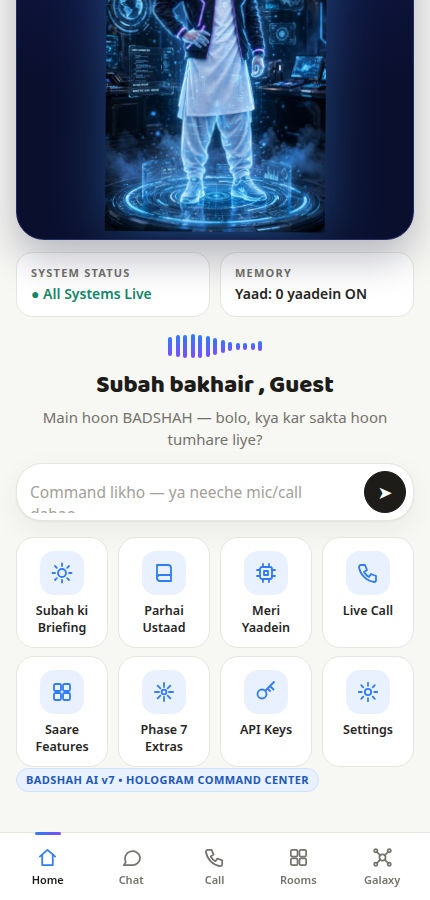
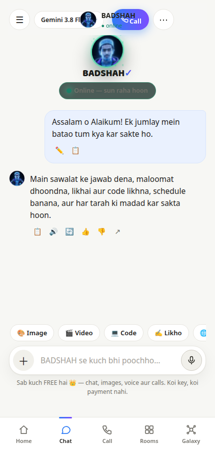
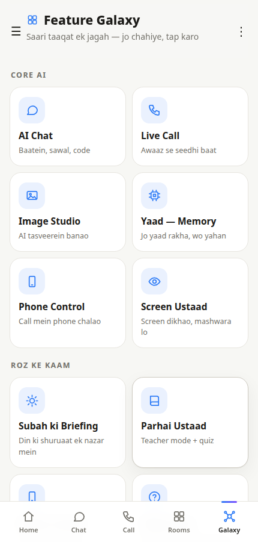

# 👑 BADSHAH AI — Voice Assistant

**Your live AI dost — chats, calls, creates images & controls your phone.**
**Free. Unlimited. Forever.**

[🌐 **Live Website**](https://badshah222-ai.pages.dev) · [📲 **Download APK**](https://badshah222-ai.pages.dev/BADSHAH-AI.apk) · [💬 **WhatsApp**](https://wa.me/923251787969)

---

## ✨ BADSHAH AI kya hai?

**BADSHAH AI** ek complete AI voice assistant hai — website + Android app — jo **Zain Shah (Badshah)** ne Swabi, Pakistan se banaya hai. Ye sirf chatbot nahi: ye **sunta hai, bolta hai, live call par baat karta hai, images banata hai, cheezein yaad rakhta hai aur phone ko voice se control karta hai** — bilkul ek asli dost ki tarah.

> *"Ek hi mission: free AI — sab ke liye."*

## 📸 Screenshots — v7.1 (naya saaf, Muse-style design)

| Home — Hologram Command Center | Chat — avatar hamesha saath | Feature Galaxy |
|---|---|---|
|  |  |  |

## 🚀 Features

| Feature | Detail |
|---|---|
| 💬 **AI Chat** | Google Gemini models (3.8 Flash · 3.5 Flash Lite · 3.1 Pro) + Groq fast models — Urdu, Roman Urdu, English |
| 📞 **Live Voice Call** | Gemini Live par asli do-tarfa call — pehle sunta hai, phir jawab deta hai, beech mein tok bhi sakte ho. **Background call**: app minimize karke bhi baat jaari |
| 🎭 **Zinda Hologram Avatar** | Call mein avatar AI ki awaaz ke saath hilta hai; emotes (Salaam, Soch, Khushi…) Hologram Test Room mein |
| 📱 **Phone Control** *(APK)* | Call/chat se **koi bhi installed app naam se kholo**, YouTube chalao, WhatsApp chat tayyar karo, torch on/off, volume control |
| 🧠 **Yaad — Memory** | "Yaad rakho: …" bolo, BADSHAH hamesha yaad rakhega — Memory page se full control (edit/delete/export) |
| 🎨 **Image Studio** | Gemini image models + free fallbacks — likho aur image tayyar |
| 🌅 **Subah ki Briefing** | Roz subah mausam + tumhari yaadein + din ki jhalak ek screen par |
| 📚 **Parhai Ustaad** | Teacher mode — subjects samjhao, quiz lo |
| 🏠 **Mode Rooms** | Kaam, Studio, Deen, Fun — har kaam ke liye alag room |
| 🔑 **BYOK Calls** | Voice call ke liye har user apni free Gemini key use karta hai — chat sab ke liye owner ki key par free |
| 👤 **Guest Mode** | Bina account chat + images — call ke liye free account |
| 🎨 **Themes** | Royal, Sunset, Ocean, Neon accents — saaf light design ke saath |
| 🛡️ **Admin Control Room** | Sirf website par: [badshah222-ai.pages.dev/admin](https://badshah222-ai.pages.dev/admin) — users, API key pool, announcements, analytics |

## 📲 Download

- **Android APK (direct install):** [badshah222-ai.pages.dev/BADSHAH-AI.apk](https://badshah222-ai.pages.dev/BADSHAH-AI.apk)
- **Web App:** [badshah222-ai.pages.dev/app](https://badshah222-ai.pages.dev/app)
- Har nayi build ke saath website wala APK khud update ho jata hai — app ke andar update notice bhi aata hai.

## 🛠️ Tech Stack

- **Frontend:** HTML/CSS/JS web app (Cloudflare Pages + Worker) — Android app ek WebView shell hai jo isi live web app ko chalata hai
- **Login:** Firebase Authentication (Email/Password + Google)
- **Backend/Database:** Supabase (PostgreSQL) — profiles, memories, API key pool, admin system
- **AI:** Gemini Live (voice calls, BYOK), Gemini + Groq (chat), Gemini Image + Pollinations (images), ElevenLabs (optional voices)
- **Android:** Kotlin, Credential Manager, foreground-service background calls, MediaProjection screen share
- **Permissions:** Minimal — Internet, Mic, Notifications. Google Play Protect friendly.

## 🔗 Mere Links

| Platform | Link |
|---|---|
| 🌐 **Website (BADSHAH AI)** | https://badshah222-ai.pages.dev |
| 🌐 **Portfolio** | https://badshah222.pages.dev |
| 📺 **YouTube — Badshah AI Websites** | https://www.youtube.com/@BadshahAIWebsites |
| 📺 **YouTube — Badshah Official** | https://www.youtube.com/@Badshahofficial-222 |
| 📸 **Instagram** | https://www.instagram.com/badshahofficial222 |
| 🎵 **TikTok** | https://www.tiktok.com/@zain_ff45 |
| 👍 **Facebook** | https://www.facebook.com/share/1Jgyv3r7vG/ |
| 💬 **WhatsApp** | [+92 325 1787969](https://wa.me/923251787969) |

---

## 📝 Changelog

### v7.1.0 — "As Like As You" Update
- Poora UI/UX **Muse-app style** mein: saaf light design, chat mein upar center avatar, Muse-style bottom bar — website aur admin panel bhi isi style mein
- Call mein avatar ab **AI ki awaaz ke saath hilta** hai (speaking/listening motion) + connect par entry animation
- Hologram Test Room mein asal **emote animations**
- **Koi bhi installed app naam se kholo** (naya Android bridge) — sirf chand apps nahi, saaray
- Galaxy icons fix (line-style), login page par purani photo ki jagah **hologram avatar**
- Admin Panel app se hata diya — ab sirf website `/admin` par

### v7.0.0 — Hologram Update
- Dark-luxury hologram UI, Phone Control in live calls (apps/YouTube/WhatsApp/torch/volume), Yaad memory system, Subah Briefing, Parhai Ustaad, Mode Rooms, Feature Galaxy, 12-category settings, 26 pages

### v6.8.0
- Background calls (foreground service), BYOK voice, mic takeover, screen share

---

**Banaya gaya pyaar ke saath — Swabi, Pakistan se 🇵🇰**
**Zain Shah (Badshah)** · MIT License

